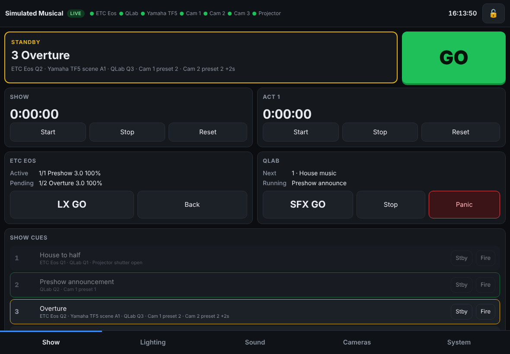
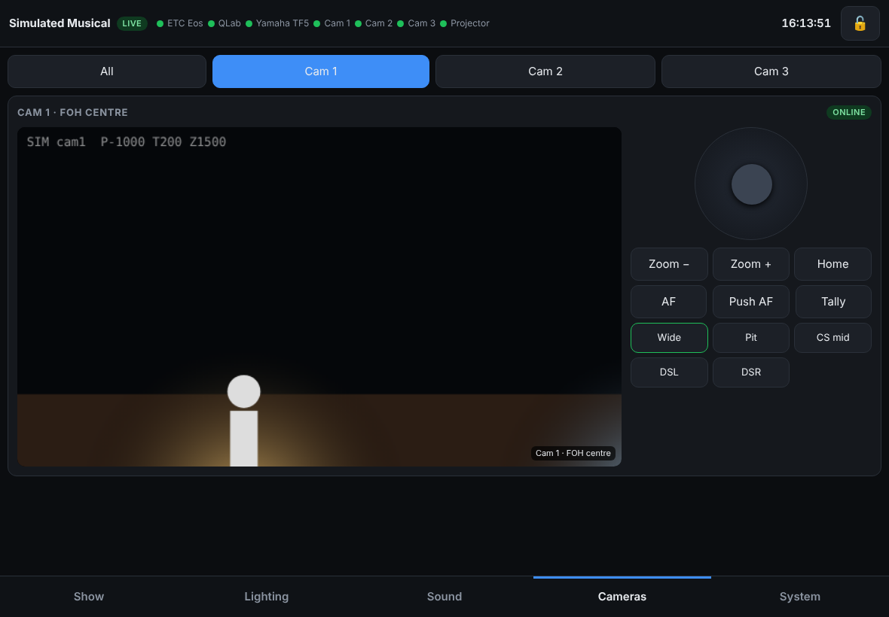
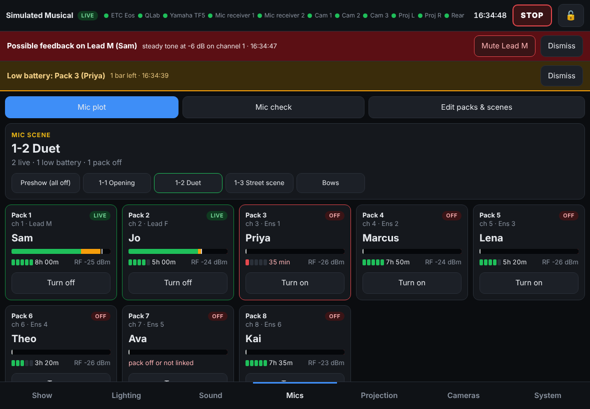

# Show Control

One touch-friendly control surface for the whole show, served from an always-on show computer
and used from an iPad or phone in a browser. It works with no internet.

| System | Protocol | Status |
|---|---|---|
| ETC Eos / Ion / Gio / Element 2 | OSC over TCP 3037 (SLIP), or UDP | GO / Back, fire cue, macros, subs, channel levels, command line; shows active/pending cue |
| Yamaha TF1/3/5 | Yamaha remote control protocol, TCP 49280 | Input + DCA + stereo faders and on/off, two-way (moves on the desk show on the iPad), scene recall |
| QLab 4/5 | OSC over UDP 53000 | GO, stop, panic, pause/resume, playhead, start any cue; shows playhead + running cues |
| PTZ cameras | VISCA-over-IP (UDP 52381) or raw VISCA TCP (5678) | Joystick pan/tilt, zoom, focus, presets (tap = recall, hold = store), tally, home, power |
| Camera video | go2rtc / MediaMTX → WebRTC, or MJPEG/HLS | Live view on the iPad, low latency |
| Panasonic projectors (PT-DZ13K, PT-DZ770 series) | Panasonic LAN protocol, TCP 1024 (+ PJLink for health) | Power with confirmation, shutter, inputs, lamp hours, fan/lamp/temperature health, lens home |
| Shure ULX-D, QLX-D, SLX-D, Axient Digital receivers | Shure text protocol, TCP 2202 | Pack battery (bars + time left), signal, whether a pack is switched on |
| Any PJLink projector / display | PJLink class 1, TCP 4352 | Power, shutter, inputs, lamp hours, health, make/model |
| grandMA2 / grandMA3 | Telnet (MA2) / OSC (MA3) command line | GO, go to cue, back, off, macros, any command line |
| ChamSys MagicQ | OSC over UDP | Playback GO, stop, release, jump to cue, level |
| Behringer X32 / Midas M32 / X Air / MR | OSC over UDP 10023 / 10024 | Faders and on/off, two-way, scene/snapshot recall (same cue steps as the TF) |
| Yamaha CL / QL / RIVAGE / DM7 | Same protocol as the TF | As TF; scene recall from the one scene list |
| Allen & Heath SQ / Qu / Avantis / dLive | MIDI over TCP | Scene recall, raw MIDI |
| Panasonic PTZ cameras (AW-UE, AW-HE) | HTTP CGI | Same as the VISCA cameras |
| Haze, fog, LED, anything DMX | sACN (E1.31) or Art-Net out | Levels with fades, raw values |
| Anything with MIDI | RTP-MIDI (Apple Network MIDI / rtpMIDI) | MIDI Show Control, notes, CC, program change |
| 700+ other kinds of gear | Bitfocus Companion (HTTP) | Press any Companion button from a cue: ATEM, Avolites, Hog, DiGiCo, vMix… |
| Anything else | OSC, text over TCP/UDP, HTTP | With ready-made commands for Resolume, Millumin, HyperDeck, Videohub, Watchout, Shelly |

**Setting it up from the iPad:** System > Guided set-up walks through it one step at a time.
"Find equipment on the network" asks the show network what's there (PJLink, Panasonic, Yamaha,
X32, Art-Net consoles and nodes, Sony-style cameras, QLab, Companion, HyperDeck...), and
"Add equipment" has 50+ makes and models with what to press on each one.
New kinds of equipment can be added as plugins without changing the app: see [plugins/README.md](plugins/README.md).

**Show cues** tie it together: one GO can fire an Eos cue, a QLab cue, a TF scene and camera
presets, with optional per-action delays. There are also show/act timers, a lock button so a
pocketed phone can't fire anything, and an optional PIN.

<p>
  
  
</p>

## Stage manager and crew screens

Other people in the company open their own page on a phone, iPad or TV (same address, different page):

| Page | For | What it does |
|---|---|---|
| `/sm.html` | Stage manager | Big standby cue and GO, cue notes, which crew are standing by, show/act timers. Side panels: calls, rehearsal notes (tagged with the cue and show time, export to a spreadsheet), script with cue places that follows the show, show night checklist with sign-off, crew cue lights, countdown and lobby message |
| `/crew.html` | Crew phones | Pick your job once. Your own run sheet, a cue light that turns amber at standby (tap "Standing by") and green at GO, and calls like "Five minutes please" with a Got it button |
| `/foh.html` | Front of house manager | House not open / open / hold / closed / interval, seen instantly by the stage manager; calls; lobby message |
| `/lobby.html` | Lobby TV | The show name and a big countdown to the start or the end of the interval |

Crew roles, the checklist and the script are saved in the show file under `"crew"`; give a cue crew tasks in
Show → Edit cues. Notes, ticks and calls are kept across a restart. The 🌙 button on every screen switches
that device to a dim, red-only night mode for backstage.

## Easiest way to try it (Mac or Windows, nothing to install)

1. Go to [Releases](https://github.com/roccomatusic-max/TheaterControl/releases) and download
   **ShowControl-mac.zip** or **ShowControl-windows.zip**.
2. Open the zip (on Windows: right-click → Extract All).
3. Double-click **Show Control.command** (Mac) or **Start Show Control.bat** (Windows).
   - **Mac, first time only:** macOS says it can't check the app for malware. Click **Done**, open
     **System Settings → Privacy & Security**, scroll down and click **Open Anyway**, then enter your password.
   - **Windows:** if "Windows protected your PC" appears, click **More info → Run anyway**. If the
     firewall asks about Node.js, allow it on private networks.
4. Your browser opens with a QR code. Scan it with the iPad camera to open the controls on the iPad.

It starts in **practice mode** with simulated equipment. To use your real gear, open
**System → Set up real equipment** on the iPad: type each device's address, tap **Test**, then **Go live**.
Each device has a "How to set it up" list for the settings to turn on at the device. Show Control restarts
itself into live mode, and your cue list comes with you. The setup is saved in `Show Control/show.json` in
your home folder (`"live": false` there means practice mode). On the same screen you can make Show Control
start automatically when the computer turns on; while it runs, a Mac is kept from going to sleep.

To build the downloads yourself: `npm run package`. When `main` gets a new `version` in `package.json`, GitHub Actions publishes a release with both downloads.

## Try it now (no hardware, for developers)

```bash
npm install
npm run sim        # fake Eos, TF5, QLab, 3 PTZ cams, projector + the server
# open http://<this-computer>:8080 on your iPad or phone
npm test           # end-to-end checks against the simulators (show + projection)
```

The simulators speak the real protocols, so the same drivers talk to the real gear.

## Run it for real

1. Install Node.js 20+ on the show server and copy this folder to it.
2. `npm install --omit=dev`
3. Edit `config/show.json` (start from `config/show.example.json`): device IPs, cameras, show cues.
4. `npm start`, then open the printed URL on the iPad. In Safari use **Share → Add to Home Screen** to get a full-screen app.
5. To run it 24/7, use `deploy/show-control.service` (Linux), `deploy/com.show-control.plist` (macOS),
   or on Windows `nssm install ShowControl "C:\Program Files\nodejs\node.exe" server\index.js`.

### Console / device setup

- **Eos**: Setup → Show/System → Shell (Setup) → Network: enable **OSC TCP** (Eos v3+ listens on 3037,
  SLIP framing) and give the console a static IP on the show network. If you use UDP instead,
  set the OSC UDP RX/TX ports and `"transport": "udp"`.
- **TF5**: set a static IP on the desk (Setup → Network). No other setting needed. Scene recall uses
  `ssrecall_ex scene_a <n>`. Check this on the real desk first, because the scene command syntax varies by firmware.
- **QLab 5**: Workspace Settings → Network: allow OSC, and set a passcode if you want one (put it in
  `"passcode"`).
- **PTZ**: set static IPs and enable VISCA-over-IP (Sony style, UDP 52381) or note the TCP port
  for PTZOptics-style raw VISCA (`"protocol": "visca-tcp", "port": 5678`).
- **Panasonic projectors**: give each a static IP. If the projector has a web-control password,
  put its login in `"username"` (usually `admin1`) and `"password"`. PJLink should stay enabled,
  because that's where fan, lamp and temperature health comes from.
- **Other projectors**: enable PJLink and set its password in `"password"`.

## Network

```
                 ┌──────────── Show network (wired, isolated, no internet) ────────────┐
                 │  Eos 10.101.100.101   TF5 .50.20   QLab Mac .50.10                    │
                 │  PTZ cams .60.11-13   Projector .60.30                               │
                 └──────────────────────────────┬──────────────────────────────────────┘
                                                │ NIC 1
                                       ┌────────┴────────┐
                                       │   Show server   │  Show Control + go2rtc + Tailscale
                                       └────────┬────────┘
                                                │ NIC 2
                 ┌──────────── Control network (Wi-Fi AP + router with internet) ──────┐
                 │  iPad, phone                         internet ⇄ Tailscale (remote fix) │
                 └──────────────────────────────────────────────────────────────────────┘
```

- Only the server is on both networks. The iPad never talks to the gear directly, and nothing on
  the show network can reach the internet.
- Set `"server": { "host": "<control-NIC-IP>" }` to serve the UI only on the control network.
- **Remote access**: install Tailscale on the server and your phone/laptop. It only makes outbound connections, so there's
  no port forwarding. From anywhere, open `http://<server-tailscale-name>:8080`, or SSH/remote desktop in.
- Use a dedicated 5 GHz access point for the control network with a hidden SSID and WPA2/3. Don't share it with the house or cast Wi-Fi.
- Turn off automatic OS updates and sleep on the server during the run.
- If the TF5 carries Dante, keep Dante on its own network or VLAN.

## Sound and mics

- **Level meters**: the Sound tab shows a live meter beside every input fader. They come from the TF5 at
  10 updates a second. (The meter request, `mtrstart MIXER:Current/Meter/InCh 100`, still has to be checked on the
  real desk. If the desk refuses it, the app says "meters not available" and everything else carries on.
  `"meterPath"` and `"meterMs"` on the mixer override it.)
- **Feedback alert**: a channel that holds a steady tone above -12 dB for a second raises a red alert on every
  iPad and phone, with a one-tap mute for that channel. Singing moves around too much to trip it, but a long
  held note into a hot mic can. Tune or turn it off with `"sound": { "feedback": { "enabled": true, "minDb": -12, "holdMs": 1000, "steadyDb": 3 } }`.
- **Mics tab: mic plot**: every radio mic pack with who wears it, its mixer channel (live/off), meter, battery
  and signal. Scenes say which packs are live (and who wears a pack when a cover or swap has it). Tapping a scene,
  or a show cue with "Switch mics to scene", turns each pack's channel on or off on the TF5 to match. A low pack
  battery raises an alert naming the actor.
- **Mic check**: steps through the packs one at a time with a big meter. It ticks "heard on the desk" by itself
  when the mic comes through, and you mark each one Good or Problem.
- Packs and scenes are edited on the iPad (Mics → Edit packs & scenes) and saved in the show file under `"mics"`.
  Receivers are added on System → Equipment setup.

<p></p>

## Projection

The **Projection** tab works like Projector Control, without mapping. It has:

- Groups from `"projection": { "groups": [...] }` plus a built-in **All projectors** group.
  Show cues address a group as `"device": "group:foh"`.
- **Close all shutters** on the Show tab, which blanks every projector in one tap.
- A clear result from each projector for every command. The app keeps these outcomes separate: *busy*
  (for example cooling down), *rejected*, *unsupported*, *timed out*, *password refused* and
  *not sent*. A projector that's cooling down is never reported as "can't do that".

It uses the same safety rules as Projector Control:

- **Power is confirmed by reading it back.** A power command is never retried after a timeout, and the app queries the projector instead.
- **Panasonic shutter polarity lives in one place** (`OSH:1` = closed).
- **Commands only documented for sibling models aren't sent** unless that projector has
  `"allowUnverified": true`. Freeze is the one such command today.
- **The app never shows a number the projector didn't report.** Unknown values show as `—`, and the
  Panasonic temperatures that aren't read show as "not read".
- **An input the projector refuses while it's on and settled is crossed out** on that unit
  (for example, SDI with no SDI board fitted).

Nothing has been tested on a physical projector yet. Before the first show, use the
[hardware validation steps](https://github.com/roccomatusic-max/Projectionmapping/blob/main/docs/HARDWARE-VALIDATION.md)
from Projector Control.

## Video

Browsers (especially iPad Safari) can't play RTSP or NDI directly. Run **go2rtc** on the server
(`deploy/go2rtc.yaml`). It pulls each camera's RTSP once and serves WebRTC to every tablet with
well under a second of delay. In the camera config:

```json
"stream": { "type": "go2rtc", "url": "http://<server>:1984", "src": "cam1" }
```

Other options: `"mediamtx"` (MediaMTX WebRTC page), `"mjpeg"` (camera's own MJPEG URL),
`"hls"` (works natively on iOS, a few seconds of delay), `"iframe"`.
For NDI|HX cameras, turn on their RTSP output, or bridge NDI to RTSP on the server.
For recording or streaming the show, OBS on the server can take the same feeds.

## How it's built

```
server/index.js          HTTP + WebSocket hub, show cue stack, timers, PIN, log
server/drivers/*.js      one driver per device type; each exposes status, state, command()
server/catalog.js        the "Add equipment" list: makes/models → driver, defaults, set-up steps
server/discover.js       "Find equipment on the network"
server/plugins.js        loads extra drivers from plugins/ and ~/Show Control/plugins/
server/lib/osc.js        OSC encode/decode + SLIP framing (no dependencies)
public/                  the iPad/phone app (plain JS/CSS, no build step, no CDN)
sim/                     protocol-accurate fake devices
config/*.json            device list, show cues, UI layout
```

Adding a device type means adding one file in `server/drivers/` and one line in `drivers/index.js`
(or dropping a plugin file in `plugins/`). Adding another brand of something already supported is
one line in `server/catalog.js`.

## Next ideas

- Projection mapping (shared with Projector Control's mapping module)
- Cue editor in the UI (today cues are edited in `config/show.json`)
- MIDI timecode out
- LTC/MTC display and chase, Clear-Com/Green-GO comms status
- Backstage and front-of-house paging through QLab
- Per-user roles (SM: GO only; TD: everything)
